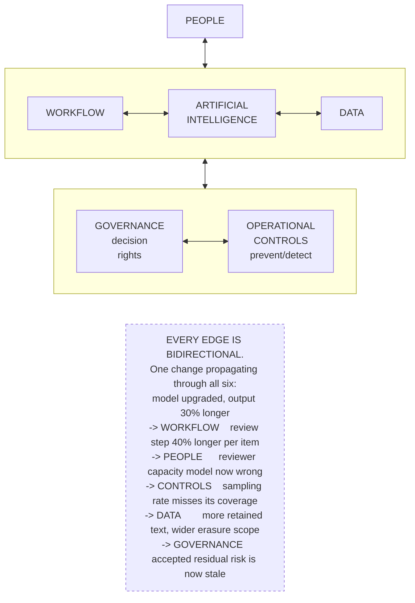

# G1. The socio-technical system

*Enterprise AI Architecture Primer, Appendix G, entry G1. Source of record for the text: this file; the ASCII original is preserved below.*



**What it shows.** An enterprise artificial intelligence deployment is six interacting elements whose behavior is a property of the interactions, not of the components.

**Three things to point at.** The absence of a hierarchy: no element is the center, and the model is one box of six. The bidirectional edges: requirements flow both ways, so a change to one element changes what the other five require. The worked propagation: a supplier shipped a better model and nobody in the organization made a decision, yet five elements fell out of specification.

**The failure it makes visible.** A change log confined to one element is a false record of the system. If a proposed change lists "none" against five of six elements, the analysis was not done.

<details><summary>ASCII original</summary>

```
                        +-------------+
                        |   PEOPLE    |
                        +------+------+
                               |
        +----------------------+---------------------+
        |                      |                     |
  +-----+------+        +------+------+       +------+-----+
  |  WORKFLOW  |--------| ARTIFICIAL  |-------|    DATA    |
  +-----+------+        | INTELLIGENCE|       +------+-----+
        |               +------+------+              |
        +----------------------+---------------------+
                               |
        +----------------------+---------------------+
        |                                            |
  +-----+--------+                          +--------+-------+
  |  GOVERNANCE  |--------------------------|  OPERATIONAL   |
  |  decision    |                          |  CONTROLS      |
  |  rights      |                          |  prevent/detect|
  +--------------+                          +----------------+

   EVERY EDGE IS BIDIRECTIONAL.
   One change propagating through all six:
     model upgraded, output 30% longer
       -> WORKFLOW    review step 40% longer per item
       -> PEOPLE      reviewer capacity model now wrong
       -> CONTROLS    sampling rate misses its coverage
       -> DATA        more retained text, wider erasure scope
       -> GOVERNANCE  accepted residual risk is now stale
```

</details>

**Final Liability rests with the Human.**
