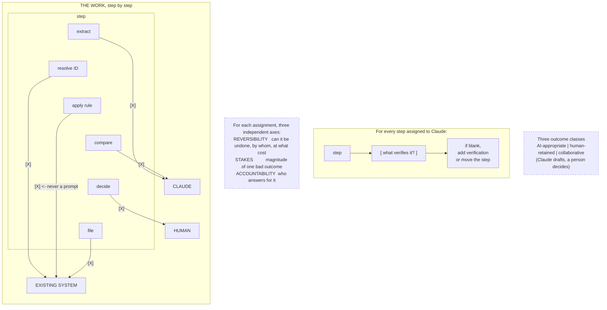

# G2. The delegation map

*Enterprise AI Architecture Primer, Appendix G, entry G2. Source of record for the text: this file; the ASCII original is preserved below.*



**What it shows.** Ownership of each step was decided rather than defaulted, and the second owner is existing systems, meaning what the organization already paid to make reliable.

**Three things to point at.** The middle column, which is the one teams forget. The verification arrow, which is empty on at least one row in most real designs. The deterministic rule sitting in the existing-system column, because that is the row that migrates into a prompt when nobody is watching.

**The failure it makes visible.** Over-assignment to the model. Absence of this map is the best single predictor of it, and the map takes ten minutes to draw and an hour to argue about, which is the hour worth having.

<details><summary>ASCII original</summary>

```
  THE WORK, step by step
  ---------------------------------------------------------
  step        CLAUDE      EXISTING SYSTEM     HUMAN
  ---------------------------------------------------------
  extract       [X]
  resolve ID                   [X]
  apply rule                   [X]   <- never a prompt
  compare       [X]
  decide                                       [X]
  file                         [X]
  ---------------------------------------------------------
  For each assignment, three independent axes:
     REVERSIBILITY   can it be undone, by whom, at what cost
     STAKES          magnitude of one bad outcome
     ACCOUNTABILITY  who answers for it

  For every step assigned to Claude:
        step ---> [ what verifies it? ] ---> if blank,
                                             add verification
                                             or move the step

  Three outcome classes
     AI-appropriate | human-retained | collaborative
     (Claude drafts, a person decides)
```

</details>

**Final Liability rests with the Human.**
