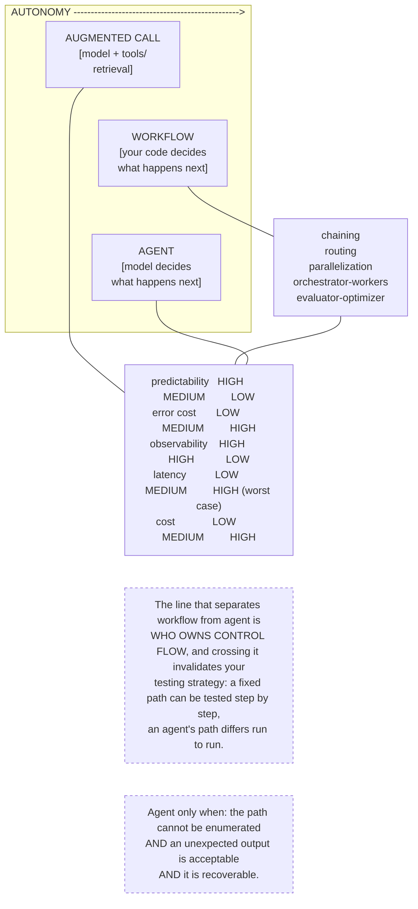

# G3. The three patterns compared

*Enterprise AI Architecture Primer, Appendix G, entry G3. Source of record for the text: this file; the ASCII original is preserved below.*



**What it shows.** Three points on an autonomy spectrum with the five workflow sub-patterns underneath, and the factor grid that decides between them.

**Three things to point at.** The control-flow line, which is the only structural distinction and not a matter of degree. The five factors, where the tightest constraint decides and error cost usually is it. The three-part conjunction on the agent, all of which must hold.

**The failure it makes visible.** Premature escalation. An agent deployed over a routed workflow that was never baselined, which shows up as a design nobody can test and a latency budget set on the median rather than the worst case.

<details><summary>ASCII original</summary>

```
  AUTONOMY ------------------------------------------------>
  ---------------------------------------------------------
  AUGMENTED CALL      WORKFLOW              AGENT
  [model + tools/     [your code decides    [model decides
   retrieval]          what happens next]    what happens next]
       |                    |                     |
       |              chaining                    |
       |              routing                     |
       |              parallelization             |
       |              orchestrator-workers        |
       |              evaluator-optimizer         |
       |                    |                     |
  ---------------------------------------------------------
  predictability   HIGH        MEDIUM         LOW
  error cost       LOW         MEDIUM         HIGH
  observability    HIGH        HIGH           LOW
  latency          LOW         MEDIUM         HIGH (worst case)
  cost             LOW         MEDIUM         HIGH
  ---------------------------------------------------------
  The line that separates workflow from agent is
  WHO OWNS CONTROL FLOW, and crossing it invalidates your
  testing strategy: a fixed path can be tested step by step,
  an agent's path differs run to run.

  Agent only when: the path cannot be enumerated
               AND an unexpected output is acceptable
               AND it is recoverable.
```

</details>

**Final Liability rests with the Human.**
