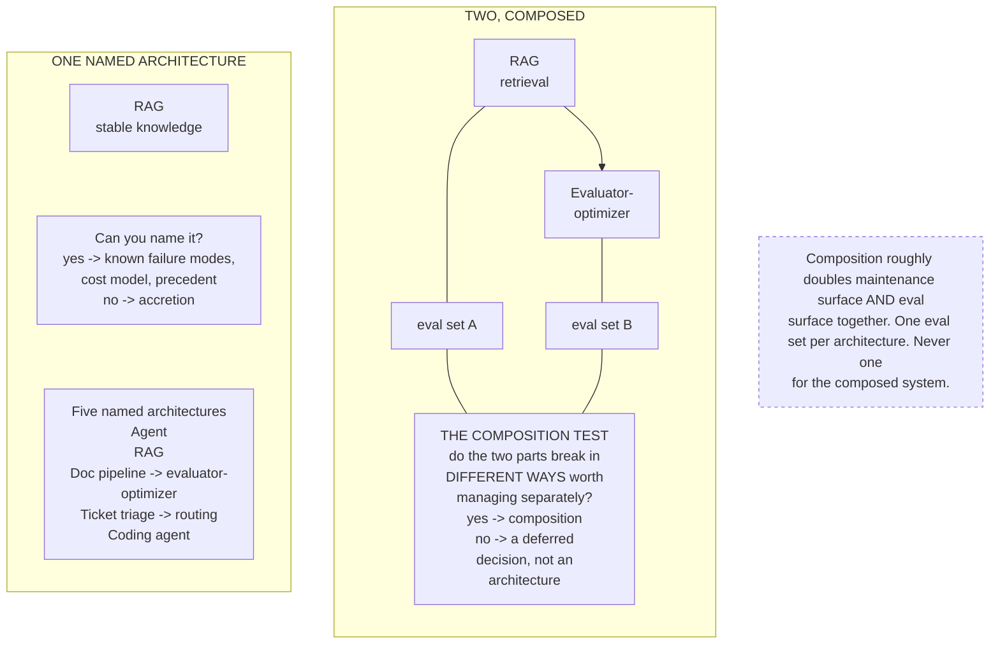

# G4. The reference architecture composition

*Enterprise AI Architecture Primer, Appendix G, entry G4. Source of record for the text: this file; the ASCII original is preserved below.*



**What it shows.** Whether the architecture was chosen or accreted, and whether a second pattern earned its place.

**Three things to point at.** The naming question, which is the cheapest diagnostic in the material. The two separate eval sets, because a single end-to-end set reports top-level health while a component rots. The composition test, which is a question about failure modes and not about capability.

**The failure it makes visible.** A composed system evaluated end to end, and a second pattern present because the problem was never decided.

<details><summary>ASCII original</summary>

```
  ONE NAMED ARCHITECTURE                TWO, COMPOSED
  +--------------------+       +------------+   +------------+
  |  RAG               |       | RAG        |-->| Evaluator- |
  |  stable knowledge  |       | retrieval  |   | optimizer  |
  +--------------------+       +------------+   +------------+
                                     |                |
  Can you name it?               eval set A       eval set B
   yes -> known failure modes,      |                |
          cost model, precedent     +-------+--------+
   no  -> accretion                         |
                                    THE COMPOSITION TEST
  Five named architectures         do the two parts break in
   Agent                           DIFFERENT WAYS worth
   RAG                             managing separately?
   Doc pipeline -> evaluator-        yes -> composition
     optimizer                       no  -> a deferred
   Ticket triage -> routing                decision, not an
   Coding agent                            architecture

  Composition roughly doubles maintenance surface AND eval
  surface together. One eval set per architecture. Never one
  for the composed system.
```

</details>

**Final Liability rests with the Human.**
