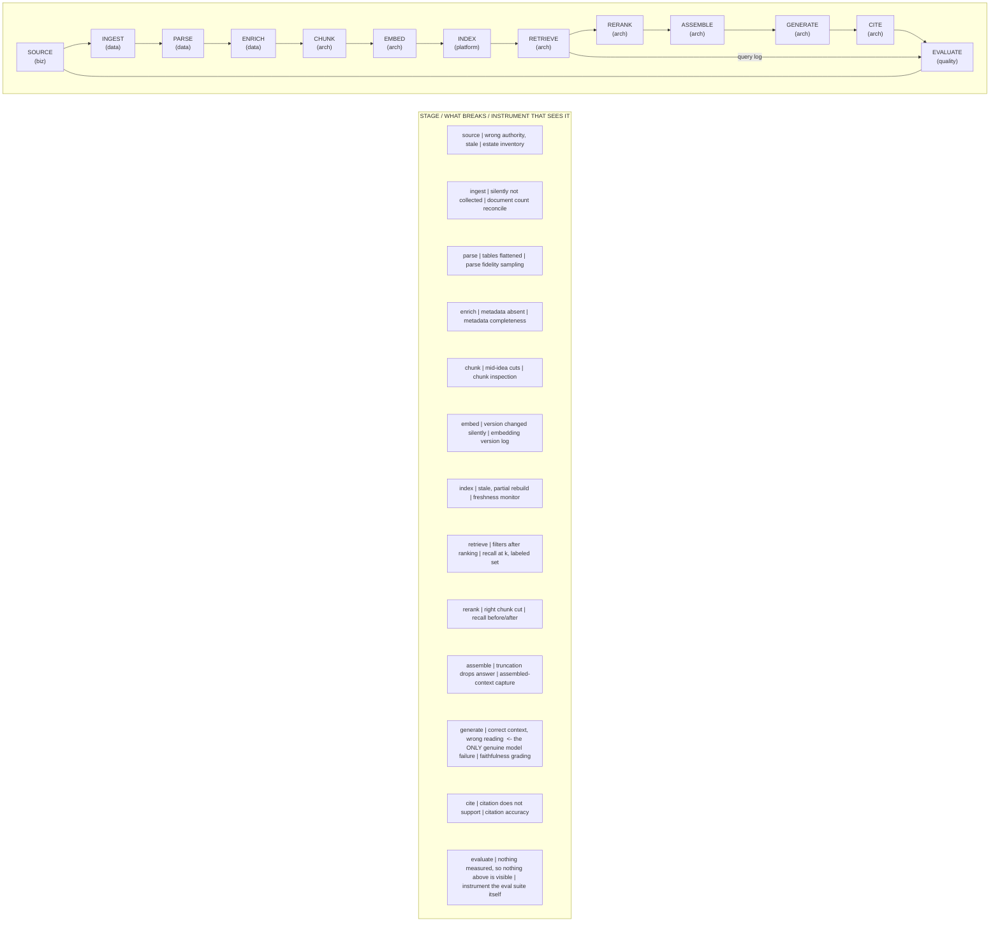

# G5. The retrieval pipeline with owners

*Enterprise AI Architecture Primer, Appendix G, entry G5. Source of record for the text: this file; the ASCII original is preserved below.*



**What it shows.** Retrieval is thirteen stages with distinct owners, distinct failures and distinct instruments, not a technique.

**Three things to point at.** The owner row, where the first four stages belong to the business and to data engineering rather than to architecture. The single stage that is a model failure. The query log feeding back into evaluation, which is the loop most implementations never close.

**The failure it makes visible.** Failure attribution. "The answer was wrong" is reported as a model defect nearly always and is one nearly never. Teams upgrade models against a corpus problem, see no improvement and conclude the technology is immature.

<details><summary>ASCII original</summary>

```
 SOURCE -> INGEST -> PARSE -> ENRICH -> CHUNK -> EMBED
 (biz)     (data)    (data)   (data)   (arch)  (arch)
   |                                              |
   |                                              v
 EVALUATE <- CITE <- GENERATE <- ASSEMBLE <- RERANK <- INDEX
 (quality)  (arch)   (arch)      (arch)     (arch)  (platform)
   ^                                              |
   |                RETRIEVE (arch) <-------------+
   +------------------ query log -----------------+

 STAGE          WHAT BREAKS          INSTRUMENT THAT SEES IT
 source     wrong authority, stale   estate inventory
 ingest     silently not collected   document count reconcile
 parse      tables flattened         parse fidelity sampling
 enrich     metadata absent          metadata completeness
 chunk      mid-idea cuts            chunk inspection
 embed      version changed silently embedding version log
 index      stale, partial rebuild   freshness monitor
 retrieve   filters after ranking    recall at k, labeled set
 rerank     right chunk cut          recall before/after
 assemble   truncation drops answer  assembled-context capture
 generate   correct context, wrong   faithfulness grading
            reading  <- the ONLY genuine model failure
 cite       citation does not support citation accuracy
 evaluate   nothing measured, so     instrument the eval
            nothing above is visible suite itself
```

</details>

**Final Liability rests with the Human.**
