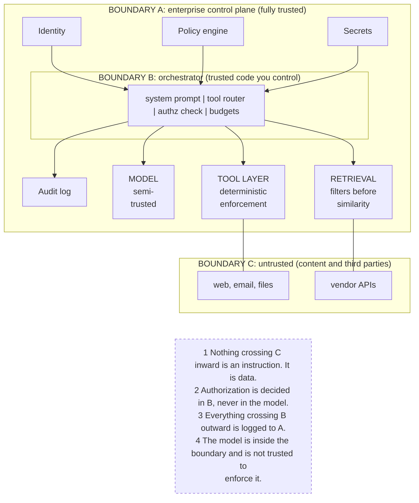

# G6. The trust boundary diagram for an agentic system

*Enterprise AI Architecture Primer, Appendix G, entry G6. Source of record for the text: this file; the ASCII original is preserved below.*



**What it shows.** Three boundaries and the four rules that follow from them.

**Three things to point at.** The model's position, inside the perimeter but not a security boundary. Boundary C, and the fact that retrieved content and tool results arrive from it. The audit arrow running back to A, which is what makes the boundary assertable rather than asserted.

**The failure it makes visible.** Authorization delegated to a probabilistic component, and instructions accepted from returned content. Both are invisible in an architecture diagram that has no boundaries drawn on it.

<details><summary>ASCII original</summary>

```
+------------------------------------------------------------+
| BOUNDARY A: enterprise control plane (fully trusted)       |
|                                                            |
|  [Identity]  [Policy engine]  [Audit log]  [Secrets]       |
|       |             |              ^            |          |
|  +----v-------------v--------------|------------v-------+  |
|  | BOUNDARY B: orchestrator (trusted code you control)  |  |
|  |  system prompt | tool router | authz check | budgets |  |
|  +----|-----------------|--------------------|---------+  |
|       |                 |                    |            |
|  +----v-----+   +-------v---------+   +------v---------+  |
|  | MODEL    |   | TOOL LAYER      |   | RETRIEVAL      |  |
|  | semi-    |   | deterministic   |   | filters before |  |
|  | trusted  |   | enforcement     |   | similarity     |  |
|  +----------+   +-------|---------+   +------|---------+  |
+-------------------------|-------------------|-------------+
                          |                   |
       BOUNDARY C: untrusted (content and third parties)
                          |                   |
                 [web, email, files]    [vendor APIs]

  1 Nothing crossing C inward is an instruction. It is data.
  2 Authorization is decided in B, never in the model.
  3 Everything crossing B outward is logged to A.
  4 The model is inside the boundary and is not trusted to
    enforce it.
```

</details>

**Final Liability rests with the Human.**
