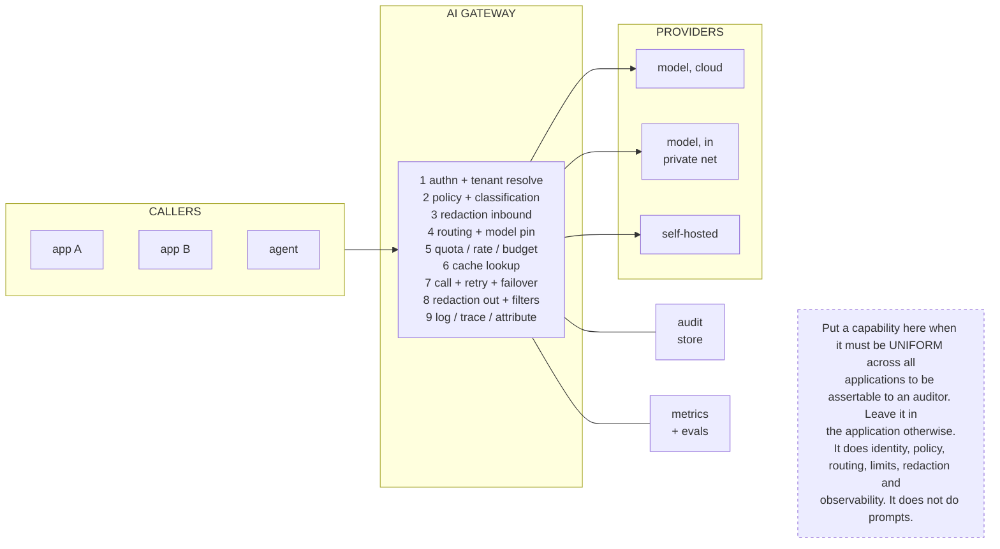

# G7. The AI gateway as a control point

*Enterprise AI Architecture Primer, Appendix G, entry G7. Source of record for the text: this file; the ASCII original is preserved below.*



**What it shows.** The single point through which all model traffic passes, and the nine functions that cannot live in eleven applications consistently.

**Three things to point at.** Step 2, where classification selects the route before cost or latency is considered. Step 9, which is the evidence base and the cost attribution simultaneously. The three provider boxes, which is what routing by classification buys.

**The failure it makes visible.** Policy implemented eleven times inconsistently, keys that cannot be rotated without coordinated releases and cost that cannot be attributed retroactively. Also the gateway's own three failure modes: a single point of failure, a change bottleneck teams route around and a second place business logic lives.

<details><summary>ASCII original</summary>

```
 CALLERS            AI GATEWAY                    PROVIDERS
 +--------+   +---------------------------+   +--------------+
 | app A  |-->| 1 authn + tenant resolve  |-->| model, cloud |
 | app B  |   | 2 policy + classification |   +--------------+
 | agent  |   | 3 redaction inbound       |
 +--------+   | 4 routing + model pin     |   +--------------+
              | 5 quota / rate / budget   |-->| model, in    |
              | 6 cache lookup            |   | private net  |
              | 7 call + retry + failover |   +--------------+
              | 8 redaction out + filters |
              | 9 log / trace / attribute |   +--------------+
              +---------------------------+-->| self-hosted  |
                     |            |           +--------------+
                 +-------+   +---------+
                 | audit |   | metrics |
                 | store |   | + evals |
                 +-------+   +---------+

  Put a capability here when it must be UNIFORM across all
  applications to be assertable to an auditor. Leave it in
  the application otherwise.
  It does identity, policy, routing, limits, redaction and
  observability. It does not do prompts.
```

</details>

**Final Liability rests with the Human.**
