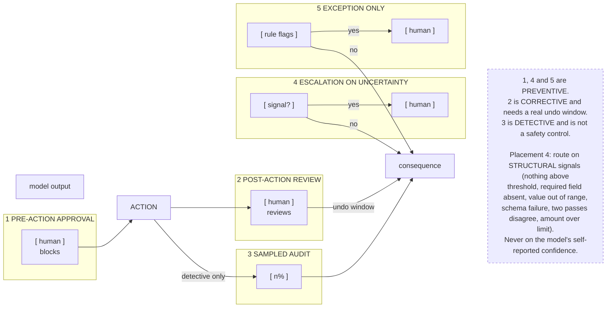

# G8. The human-in-the-loop placements

*Enterprise AI Architecture Primer, Appendix G, entry G8. Source of record for the text: this file; the ASCII original is preserved below.*



**What it shows.** Five placements positioned against the action, with the control class of each.

**Three things to point at.** Where each sits relative to the action, because that is what determines whether it prevents anything. Row 3, which is a quality instrument and is routinely presented as a safety control. Row 4's signal list, because the wrong input there is the most common design error in the set.

**The failure it makes visible.** A sampled audit described as the control that makes an irreversible action safe, and post-action review applied to something that cannot actually be reversed, such as anything already sent to a client.

<details><summary>ASCII original</summary>

```
                 model output       ACTION       consequence
                       |              |              |
  1 PRE-ACTION   [ human ]----------->|              |
    APPROVAL      blocks              |              |
                                      |              |
  2 POST-ACTION                       |-->[ human ]->|  undo
    REVIEW                            |    reviews   |  window
                                      |              |
  3 SAMPLED                           |--------->[ n% ]---->
    AUDIT                             |      detective only
                                      |              |
  4 ESCALATION   [ signal? ]--yes-->[ human ]        |
    ON UNCERTAINTY   |--no--------------------------->
                                      |              |
  5 EXCEPTION    [ rule flags ]-yes->[ human ]       |
    ONLY             |--no--------------------------->

  1, 4 and 5 are PREVENTIVE.
  2 is CORRECTIVE and needs a real undo window.
  3 is DETECTIVE and is not a safety control.

  Placement 4: route on STRUCTURAL signals (nothing above
  threshold, required field absent, value out of range,
  schema failure, two passes disagree, amount over limit).
  Never on the model's self-reported confidence.
```

</details>

**Final Liability rests with the Human.**
