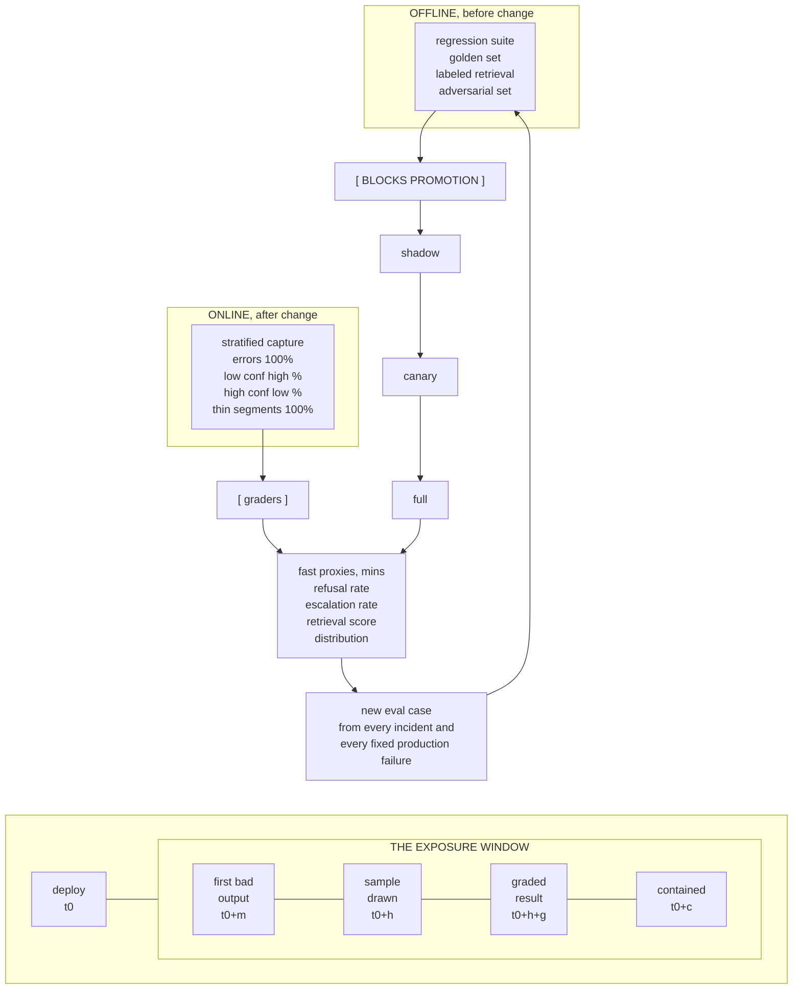

# G9. The evaluation and monitoring loop

*Enterprise AI Architecture Primer, Appendix G, entry G9. Source of record for the text: this file; the ASCII original is preserved below.*



**What it shows.** Two instrument sets on two clocks, joined by a feedback edge, plus the exposure window that quality's measurement lag creates.

**Three things to point at.** The blocking edge from offline sets to promotion. The three fast proxies, which move in minutes and are the only warning available before quality is measurable. The feedback arrow that turns every incident into a permanent eval case, which is what makes the loop compound rather than repeat.

**The failure it makes visible.** Evaluation as a launch photograph. Also the high-confidence stratum being dropped to save review budget, which removes the only instrument pointed at the failure mode that matters most.

<details><summary>ASCII original</summary>

```
   OFFLINE, before change            ONLINE, after change
   +---------------------+          +---------------------+
   | regression suite    |          | stratified capture  |
   | golden set          |          |  errors 100%        |
   | labeled retrieval   |          |  low conf   high %  |
   | adversarial set     |          |  high conf  low %   |
   +----------+----------+          |  thin segments 100% |
              |                     +----------+----------+
        [ BLOCKS PROMOTION ]                   |
              |                          [ graders ]
              v                                |
   shadow -> canary -> full  ------------------+
              |                                v
              |                     +---------------------+
              |                     | fast proxies, mins  |
              |                     |  refusal rate       |
              |                     |  escalation rate    |
              |                     |  retrieval score    |
              |                     |  distribution       |
              |                     +----------+----------+
              |                                |
              +-------- new eval case <--------+
                        from every incident and
                        every fixed production failure

   deploy   first bad   sample    graded    contained
     |         output    drawn    result       |
     |----------|----------|--------|----------|
     t0       t0+m       t0+h    t0+h+g       t0+c
                \_____________________________/
                     THE EXPOSURE WINDOW
```

</details>

**Final Liability rests with the Human.**
