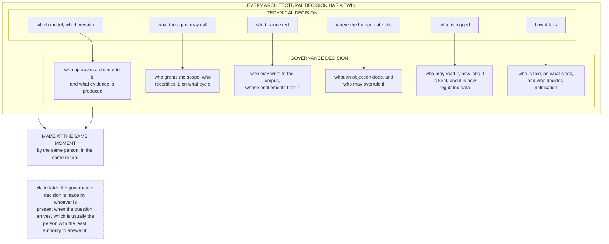

# G10. The governance moment

*Enterprise AI Architecture Primer, Appendix G, entry G10. Source of record for the text: this file; the ASCII original is preserved below.*



**What it shows.** Governance is not a review stage after design. Each technical decision carries a governance decision that is cheapest to make at the same moment.

**Three things to point at.** The pairing itself, which is the whole idea. The logging row, because every observability decision is simultaneously a compliance decision and creates regulated data. The bottom line, because deferred governance decisions are not deferred, they are delegated downward by accident.

**The failure it makes visible.** A design document with a separate governance annex, which is the physical form of a decision made twice by two people who never spoke.

<details><summary>ASCII original</summary>

```
  EVERY ARCHITECTURAL DECISION HAS A TWIN
  ---------------------------------------------------------
  TECHNICAL DECISION            GOVERNANCE DECISION
  ---------------------------------------------------------
  which model, which version -> who approves a change to it,
                                and what evidence is produced
  what the agent may call    -> who grants the scope, who
                                recertifies it, on what cycle
  what is indexed            -> who may write to the corpus,
                                whose entitlements filter it
  where the human gate sits  -> what an objection does, and
                                who may overrule it
  what is logged             -> who may read it, how long it
                                is kept, and it is now
                                regulated data
  how it fails               -> who is told, on what clock,
                                and who decides notification
  ---------------------------------------------------------
       |                                       |
       +------------------+--------------------+
                          v
             MADE AT THE SAME MOMENT
             by the same person, in the same record

  Made later, the governance decision is made by whoever is
  present when the question arrives, which is usually the
  person with the least authority to answer it.
```

</details>

**Final Liability rests with the Human.**
