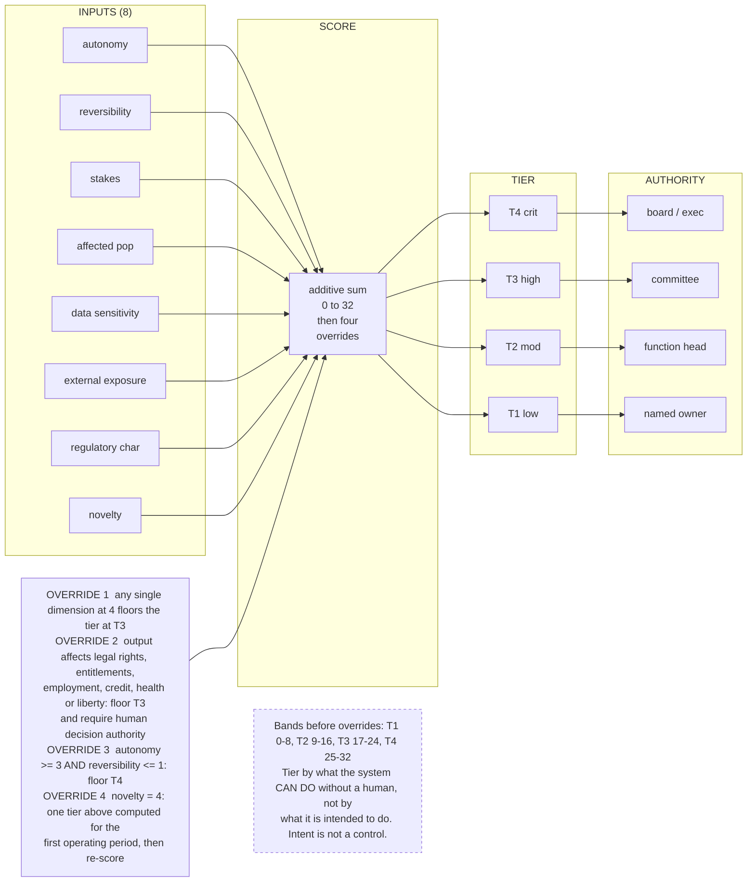

# G11. The risk tiering funnel

*Enterprise AI Architecture Primer, Appendix G, entry G11. Source of record for the text: this file; the ASCII original is preserved below.*



*Correction: the ASCII original reads "weighted sum"; Part 4 describes the tier score as an additive sum (0 to 32), so the Mermaid reads "additive sum". The ASCII original is preserved verbatim below.*

**What it shows.** Eight inputs producing a tier that determines how much of every other control applies.

**Three things to point at.** The overrides, which matter more than the arithmetic because a pure additive score lets eight moderate answers outvote one catastrophic one. The authority column, because go-live authority is the one decision right in the lifecycle matrix that moves with tier while every other row of that matrix stays fixed. That is a narrow claim about decision rights and not about the lifecycle: six other things do change per tier, from oversight placement to logging depth. The novelty dimension, which decays as operating evidence accumulates and is therefore a measure of absent evidence rather than a fudge.

**The failure it makes visible.** A tier that changes no design decision, which means the tiering did nothing. Also self-tiering, where the team scoring the system is the team whose delivery date depends on a low score.

<details><summary>ASCII original</summary>

```
 INPUTS (8)               SCORE          TIER       AUTHORITY
 ----------               -----          ----       ---------
 autonomy        \
 reversibility    \
 stakes            \
 affected pop      >-> weighted sum -> T4 crit -> board / exec
 data sensitivity /     0 to 32       T3 high -> committee
 external exposure/     then four     T2 mod  -> function head
 regulatory char /      overrides     T1 low  -> named owner
 novelty        /
                             ^
                             |
  OVERRIDE 1  any single dimension at 4 floors the tier at T3
  OVERRIDE 2  output affects legal rights, entitlements,
              employment, credit, health or liberty: floor T3
              and require human decision authority
  OVERRIDE 3  autonomy >= 3 AND reversibility <= 1: floor T4
  OVERRIDE 4  novelty = 4: one tier above computed for the
              first operating period, then re-score

  Bands before overrides: T1 0-8, T2 9-16, T3 17-24, T4 25-32
  Tier by what the system CAN DO without a human, not by
  what it is intended to do. Intent is not a control.
```

</details>

**Final Liability rests with the Human.**
