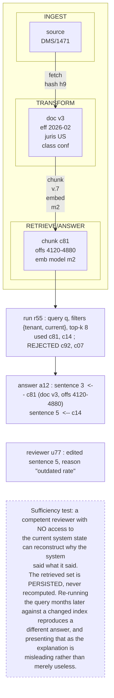

# G12. The lineage chain from source document to cited sentence

*Enterprise AI Architecture Primer, Appendix G, entry G12. Source of record for the text: this file; the ASCII original is preserved below.*



**What it shows.** Three levels of lineage, and the third one, retrieval lineage, which must be designed in and cannot be added later.

**Three things to point at.** The rejected candidates, which show what was available and not chosen and are what distinguish a governed selection from a lucky one. The sentence-level attribution, because disputes are about a sentence and not about a session. The reviewer edit, which is the difference between an assisted decision and an automated one and is frequently the decisive question.

**The failure it makes visible.** Lineage retention set by the engineering horizon rather than the dispute horizon. Observability data kept for weeks is kept for the wrong purpose when contract disputes surface years later.

<details><summary>ASCII original</summary>

```
  INGEST                TRANSFORM              RETRIEVE/ANSWER
  +----------+  fetch   +-------------+ chunk  +----------------+
  | source   |--------->| doc v3      |------->| chunk c81      |
  | DMS/1471 |  hash h9 | eff 2026-02 |  v.7   | offs 4120-4880 |
  +----------+          | juris US    | embed  | emb model m2   |
                        | class conf  |  m2    +----------------+
                        +-------------+                |
                                                       v
   run r55 : query q, filters {tenant, current}, top-k 8
             used c81, c14 ; REJECTED c92, c07
                        |
                        v
   answer a12 : sentence 3  <-- c81 (doc v3, offs 4120-4880)
                sentence 5  <-- c14
   reviewer u77 : edited sentence 5, reason "outdated rate"

  Sufficiency test: a competent reviewer with NO access to
  the current system state can reconstruct why the system
  said what it said.
  The retrieved set is PERSISTED, never recomputed. Re-running
  the query months later against a changed index reproduces a
  different answer, and presenting that as the explanation is
  misleading rather than merely useless.
```

</details>

**Final Liability rests with the Human.**
