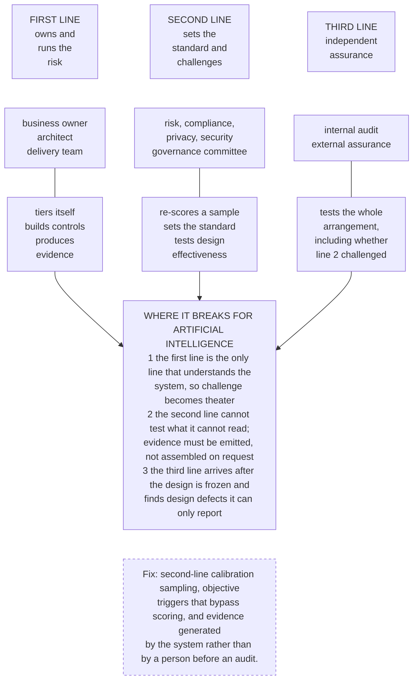

# G13. The three lines of defense applied to AI

*Enterprise AI Architecture Primer, Appendix G, entry G13. Source of record for the text: this file; the ASCII original is preserved below.*



**What it shows.** The conventional control model and the three specific places it fails when the first line holds all the expertise.

**Three things to point at.** The calibration-sampling arrow from line two, which is the cheapest working mitigation because it makes optimism visible rather than punishing it. The evidence arrow, which must originate in the running system. Line three's position, arriving late, which is the argument for pulling assurance into the design review at tier 3 and above.

**The failure it makes visible.** Effective challenge that cannot happen because only the builder understands the build. It shows up as a second line that signs everything and an audit finding written a year later about a decision nobody can now reverse.

<details><summary>ASCII original</summary>

```
 +------------+  +------------------+  +--------------------+
 | FIRST LINE |  | SECOND LINE      |  | THIRD LINE         |
 | owns and   |  | sets the         |  | independent        |
 | runs the   |  | standard and     |  | assurance          |
 | risk       |  | challenges       |  |                    |
 +------------+  +------------------+  +--------------------+
 business owner   risk, compliance,     internal audit
 architect        privacy, security     external assurance
 delivery team    governance committee
       |                  |                     |
   tiers itself      re-scores a sample     tests the whole
   builds controls   sets the standard      arrangement,
   produces          tests design           including whether
   evidence          effectiveness          line 2 challenged
       |                  |                     |
       +------------------+---------------------+
                          v
     WHERE IT BREAKS FOR ARTIFICIAL INTELLIGENCE
     1 the first line is the only line that understands the
       system, so challenge becomes theater
     2 the second line cannot test what it cannot read;
       evidence must be emitted, not assembled on request
     3 the third line arrives after the design is frozen and
       finds design defects it can only report

     Fix: second-line calibration sampling, objective
     triggers that bypass scoring, and evidence generated
     by the system rather than by a person before an audit.
```

</details>

**Final Liability rests with the Human.**
