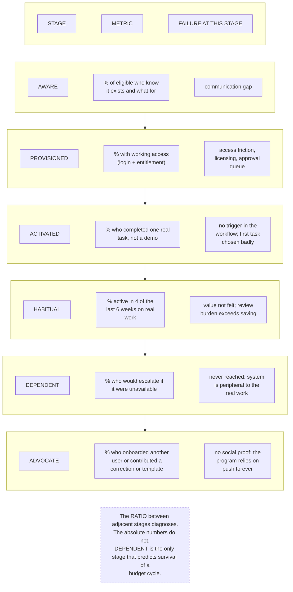

# G14. The adoption funnel

*Enterprise AI Architecture Primer, Appendix G, entry G14. Source of record for the text: this file; the ASCII original is preserved below.*



**What it shows.** Six stages, one metric each, one distinct failure each.

**Three things to point at.** The ratio rule: eighty percent provisioned against nine percent activated is a workflow-entry problem, and no amount of awareness work will move it. The dependent stage, which is the only honest predictor of survival. The advocate stage, whose absence means the program pushes forever.

**The failure it makes visible.** A healthy-looking usage number covering a system nobody would escalate about, which will be cut, and the cut will be justified using the same usage number.

<details><summary>ASCII original</summary>

```
  STAGE          METRIC                  FAILURE AT THIS STAGE
  -----          ------                  ---------------------
  AWARE       %  of eligible who know    communication gap
    |            it exists and what for
    v
  PROVISIONED %  with working access     access friction,
    |            (login + entitlement)   licensing, approval
    v                                    queue
  ACTIVATED   %  who completed one real  no trigger in the
    |            task, not a demo        workflow; first task
    v                                    chosen badly
  HABITUAL    %  active in 4 of the      value not felt; review
    |            last 6 weeks on real    burden exceeds saving
    v            work
  DEPENDENT   %  who would escalate if   never reached: system
    |            it were unavailable     is peripheral to the
    v                                    real work
  ADVOCATE    %  who onboarded another   no social proof; the
                 user or contributed a   program relies on
                 correction or template  push forever

  The RATIO between adjacent stages diagnoses.
  The absolute numbers do not.
  DEPENDENT is the only stage that predicts survival of a
  budget cycle.
```

</details>

**Final Liability rests with the Human.**
