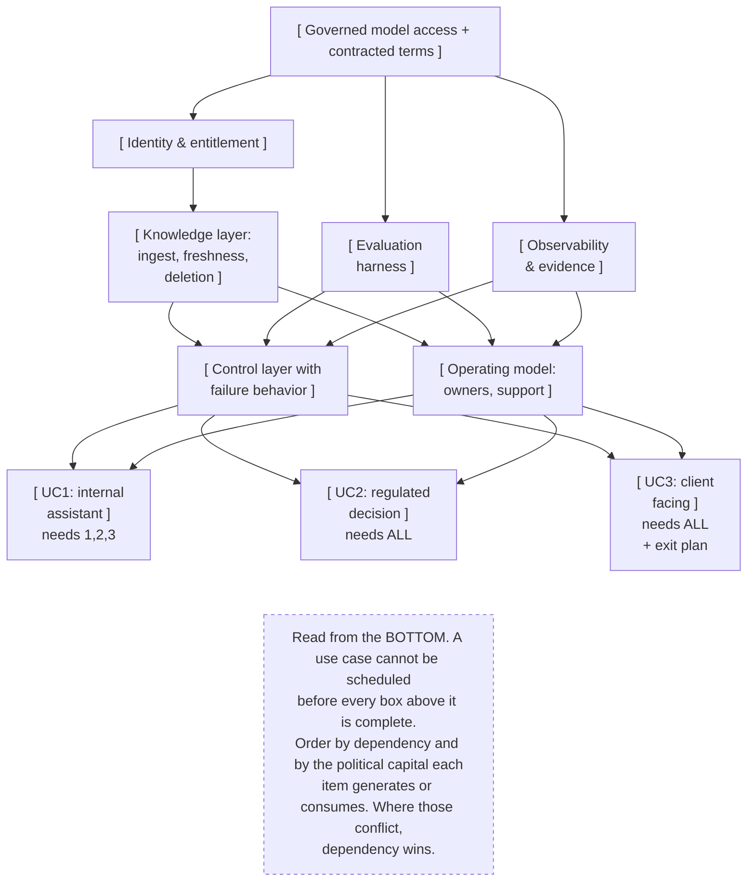

# G15. The roadmap dependency graph

*Enterprise AI Architecture Primer, Appendix G, entry G15. Source of record for the text: this file; the ASCII original is preserved below.*



**What it shows.** Capability sequence rather than a list of use cases, with each use case's prerequisites visible.

**Three things to point at.** The entitlement layer, which no single use case pays for and without which four are impossible. The regulated use case sitting last, because sequencing it early means either shipping without controls or a public failure on the most-watched item. The exit plan attached to the client-facing case rather than treated as an end-of-life activity.

**The failure it makes visible.** Which budget cut costs a quarter and which cut costs the program. A roadmap that shows only use cases cannot answer that question, so the committee cuts by cost and removes a foundation.

<details><summary>ASCII original</summary>

```
   [ Governed model access + contracted terms ]
              |
              +--------------------+-------------------+
              v                    v                   v
   [ Identity & entitlement ]  [ Evaluation ]   [ Observability
              |                  harness ]        & evidence ]
              v                    |                   |
   [ Knowledge layer:              |                   |
     ingest, freshness,            |                   |
     deletion ]                    |                   |
              |                    |                   |
              +--------+-----------+---------+---------+
                       v                     v
              [ Control layer with    [ Operating model:
                failure behavior ]      owners, support ]
                       |                     |
          +------------+------+--------------+
          v                   v              v
   [ UC1: internal      [ UC2: regulated  [ UC3: client
     assistant ]          decision ]        facing ]
     needs 1,2,3          needs ALL         needs ALL
                                            + exit plan

   Read from the BOTTOM. A use case cannot be scheduled
   before every box above it is complete.
   Order by dependency and by the political capital each
   item generates or consumes. Where those conflict,
   dependency wins.
```

</details>

**Final Liability rests with the Human.**
