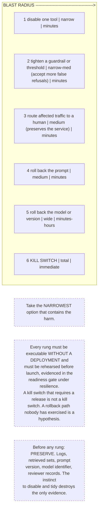

# G16. The incident containment ladder

*Enterprise AI Architecture Primer, Appendix G, entry G16. Source of record for the text: this file; the ASCII original is preserved below.*



**What it shows.** Six containment options ordered by blast radius, with the time each takes to have effect.

**Three things to point at.** Rung 3, which preserves the service while removing reliance on the system, and is the rung teams forget exists. The no-deployment requirement, which is a design constraint decided months before the incident. The preservation step above rung 1, because containment and evidence destruction are the same action if nobody says otherwise.

**The failure it makes visible.** A containment plan whose only rung is the kill switch, which means every quality problem becomes an outage, so the organization learns not to declare incidents.

<details><summary>ASCII original</summary>

```
  BLAST RADIUS ---------------------------------------->
  ------------------------------------------------------
  1 disable one tool           narrow        minutes
  2 tighten a guardrail        narrow-med    minutes
    or threshold               (accept more false refusals)
  3 route affected traffic     medium        minutes
    to a human                 (preserves the service)
  4 roll back the prompt       medium        minutes
  5 roll back the model        wide          minutes-hours
    or version
  6 KILL SWITCH                total         immediate
  ------------------------------------------------------
  Take the NARROWEST option that contains the harm.

  Every rung must be executable WITHOUT A DEPLOYMENT and
  must be rehearsed before launch, evidenced in the
  readiness gate under resilience.
  A kill switch that requires a release is not a kill
  switch. A rollback path nobody has exercised is a
  hypothesis.

  Before any rung: PRESERVE. Logs, retrieved sets, prompt
  version, model identifier, reviewer records. The instinct
  to disable and tidy destroys the only evidence.
```

</details>

**Final Liability rests with the Human.**
