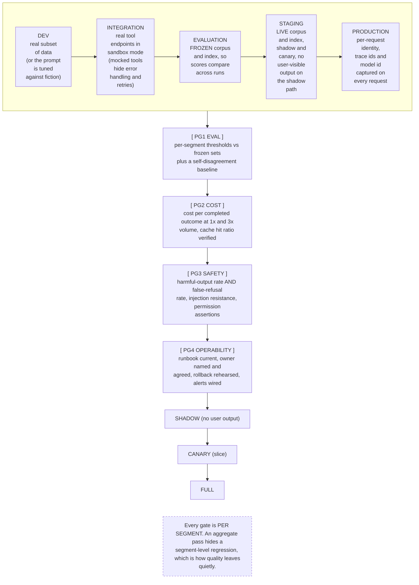

# G17. The environment and promotion pipeline

*Enterprise AI Architecture Primer, Appendix G, entry G17. Source of record for the text: this file; the ASCII original is preserved below.*



*Relabel: the promotion gates read "G1 EVAL" to "G4 OPERABILITY" in the ASCII original; they are relabeled PG1 to PG4 (promotion gate) here and in the prose so they do not collide with diagram IDs G1 to G4.*

**What it shows.** Five environments with the artificial-intelligence-specific requirement of each, and four gates that promote a candidate release tuple rather than a code build.

**Three things to point at.** The evaluation environment, which most organizations lack and which is routinely collapsed into staging. The contradiction that forces the separation: eval needs a frozen corpus for comparability, staging needs a live one for realism, and one environment cannot hold both. PG3's paired metrics, because measuring harmful output without measuring false refusal optimizes toward a system that refuses everything.

**The failure it makes visible.** An aggregate pass concealing a segment regression, and a promotion decision made on a corpus that does not resemble production, which makes every retrieval number meaningless.

<details><summary>ASCII original</summary>

```
 DEV ---> INTEGRATION ---> EVALUATION ---> STAGING ---> PRODUCTION
 real     real tool        FROZEN corpus   LIVE corpus  per-request
 subset   endpoints in     and index, so   and index,   identity,
 of data  sandbox mode     scores compare  shadow and   trace ids and
 (or the  (mocked tools    across runs     canary, no   model id
 prompt   hide error                       user-visible captured on
 is tuned handling and                     output on    every request
 against  retries)                         the shadow
 fiction)                                  path
                                                    |
                                                    v
   [ G1 EVAL ]      per-segment thresholds vs frozen sets
        |           plus a self-disagreement baseline
        v
   [ G2 COST ]      cost per completed outcome at 1x and 3x
        |           volume, cache hit ratio verified
        v
   [ G3 SAFETY ]    harmful-output rate AND false-refusal
        |           rate, injection resistance, permission
        v           assertions
   [ G4 OPERABILITY ] runbook current, owner named and
        |             agreed, rollback rehearsed, alerts wired
        v
   SHADOW (no user output) --> CANARY (slice) --> FULL

  Every gate is PER SEGMENT. An aggregate pass hides a
  segment-level regression, which is how quality leaves
  quietly.
```

</details>

**Final Liability rests with the Human.**
