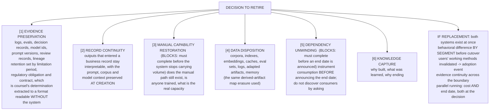

# G18. The decommissioning flow

*Enterprise AI Architecture Primer, Appendix G, entry G18. Source of record for the text: this file; the ASCII original is preserved below.*



**What it shows.** Six workstreams, two of which can block the others, plus the four recurring migration problems.

**Four things to point at.** Workstreams 3 and 5 as the blockers, per 10.6: manual capability restoration has to complete before the system stops carrying volume, and dependency unwinding before an end date is announced, so either one moves the date rather than the plan. Workstream 1 is not a blocker in that sense but is the one that most often adds quarters, because a retention period set by counsel can outlive the system by years. The derived-artifact map appearing here for the second time, having first been built for erasure. Parallel running with a stated end date, because parallel running without one becomes permanent and the organization then operates two systems, two control sets and two evidence trails.

**The failure it makes visible.** Obligations that outlive the system being discovered by whoever is present at the end, who is never the person who created them. Drawing this at design time is the argument for funding the exit plan as a deliverable.

<details><summary>ASCII original</summary>

```
  DECISION TO RETIRE
        |
        +---> [1] EVIDENCE PRESERVATION
        |         logs, evals, decision records, model ids,
        |         prompt versions, review records, lineage
        |         retention set by limitation period,
        |         regulatory obligation and contract, which
        |         is counsel's determination
        |         extracted to a format readable WITHOUT
        |         the system
        |
        +---> [2] RECORD CONTINUITY
        |         outputs that entered a business record stay
        |         interpretable, with the prompt, corpus and
        |         model context preserved AT CREATION
        |
        +---> [3] MANUAL CAPABILITY RESTORATION  (BLOCKS: must
        |         complete before the system stops carrying
        |         volume) does the manual path still exist, is
        |         anyone trained, what is the real capacity
        |
        +---> [4] DATA DISPOSITION
        |         corpora, indexes, embeddings, caches, eval
        |         sets, logs, adapted artifacts, memory
        |         (the same derived-artifact map erasure used)
        |
        +---> [5] DEPENDENCY UNWINDING  (BLOCKS: must complete
        |         before an end date is announced) instrument
        |         consumption BEFORE announcing the end date;
        |         do not discover consumers by asking
        |
        +---> [6] KNOWLEDGE CAPTURE
                  why built, what was learned, why ending
        |
        v
  IF REPLACEMENT: both systems exist at once
     behavioral difference BY SEGMENT before cutover
     users' working methods invalidated -> adoption event
     evidence continuity across the boundary
     parallel running: cost AND end date, both at the decision
```

</details>

**Final Liability rests with the Human.**
